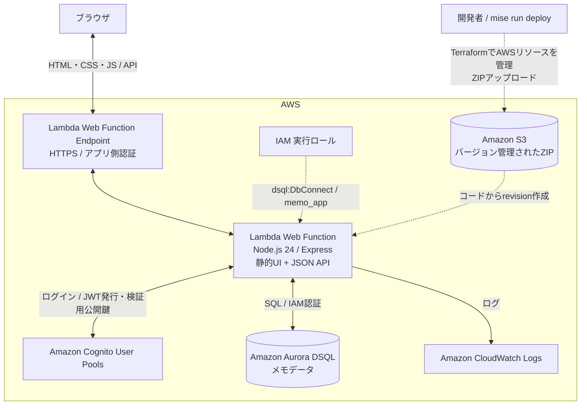

# Memo

ノートブック風のシンプルなメモアプリ。メモの作成・閲覧・編集・削除に対応します。

## 構成



- **画面**：静的ファイルもLambdaから配信し、ブラウザで描画（CSR）。CloudFront・API Gateway・Lambda Web Adapterは使いません。
- **認証**：CognitoのJWTをHttpOnly Cookieで保持し、APIで検証。メモはユーザーID（`sub`）で分離します。ユーザー作成は管理者のみです。
- **データ・デプロイ**：DSQLにはIAM認証で接続。Terraformが全リソースを管理し、更新時は新しいrevisionへ切り替えます。図の点線はデプロイ・権限の関係です。

## デプロイ

### 1. AWSリソースを作成

mise、Node.js 24以降、AWS認証情報を用意してください。pnpm・Terraformのバージョンは[mise.toml](./mise.toml)で固定しています。

デプロイにはCognito・DSQL・IAM・CloudWatch Logs・S3・Lambda Web Functionsの管理権限、`iam:PassRole`、Cloud Control API（`cloudformation:CreateResource`を含む）の権限が必要です。

```sh
mise install
mise exec -- terraform -chdir=terraform init
mise run deploy
mise exec -- terraform -chdir=terraform output -raw web_function_url
```

更新も`mise run deploy`で行えます。引数は`terraform apply`に渡されます（例：`mise run deploy -auto-approve`）。

### 2. DBを初期化（初回のみ）

`dsql:DbConnectAdmin`権限のあるAWS認証情報で実行します。DBロール・IAMマッピング・メモテーブルを作成します。**初期化前はメモを操作できません。**

```sh
export AWS_REGION="$(mise exec -- terraform -chdir=terraform output -raw aws_region)"
export DSQL_ENDPOINT="$(mise exec -- terraform -chdir=terraform output -raw dsql_endpoint)"
export WEB_FUNCTION_ROLE_ARN="$(mise exec -- terraform -chdir=terraform output -raw web_function_role_arn)"
mise exec -- pnpm --dir app install
mise exec -- pnpm --dir app run db:migrate
```

### 3. ユーザーを作成

Cognitoコンソールの対象User Poolで、メールアドレスをユーザー名として作成します。仮パスワードでログインすると、新しいパスワードを設定できます。

> Terraform以外で同名のWeb Functionや`dev` endpointを作成済みの場合は、先にimportまたは移行が必要です。

## 開発

### ローカル起動

AWS認証情報と初期化済みDSQLが必要です。ローカル実行用IAM主体にも`dsql:DbConnect`権限と`memo_app`へのIAMマッピングを設定してください。

```sh
mise exec -- pnpm --dir app install
COGNITO_USER_POOL_ID=... \
COGNITO_CLIENT_ID=... \
DSQL_ENDPOINT=... \
AWS_REGION=ap-northeast-1 \
mise exec -- pnpm --dir app start
```

起動後は http://127.0.0.1:3000 を開きます。

### テスト

AWSリソースは不要です。Terraformは事前に`init`してください。

```sh
mise exec -- pnpm --dir app test
mise exec -- terraform -chdir=terraform fmt -check -recursive
mise exec -- terraform -chdir=terraform validate
mise exec -- pnpm --dir app install --prod --frozen-lockfile --node-linker=hoisted
mise exec -- terraform -chdir=terraform test
```

## 削除

```sh
mise exec -- terraform -chdir=terraform destroy
```

**メモ・Cognitoユーザー・S3内の全デプロイパッケージも削除されます。** 必要なデータを事前に退避してください。

## 参考資料

- [AWS Lambda Web Functions](https://docs.aws.amazon.com/lambda/latest/dg/web-functions.html)
- [Aurora DSQL向けNode.jsコネクター](https://docs.aws.amazon.com/aurora-dsql/latest/userguide/SECTION_Node-js-connectors.html)
- [Amazon Cognito User Pools](https://docs.aws.amazon.com/cognito/latest/developerguide/cognito-user-pools.html)
